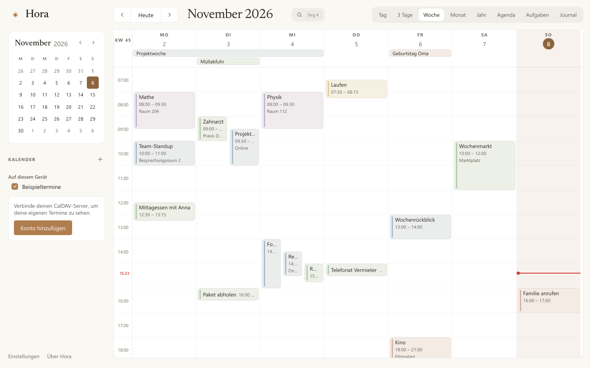
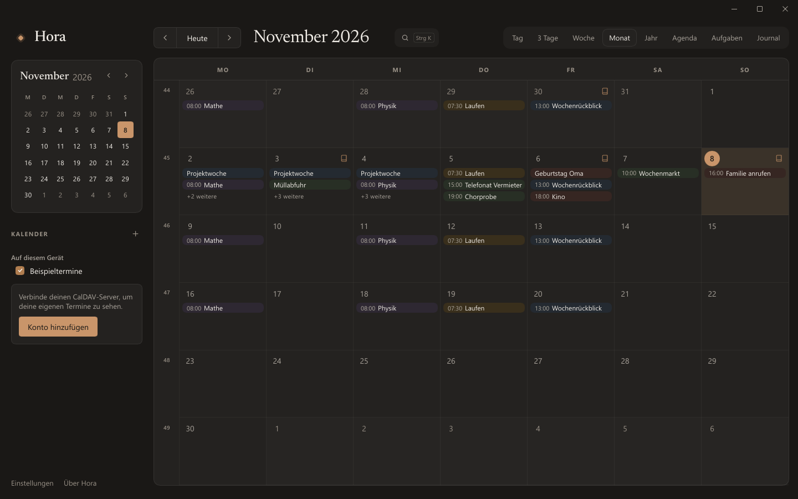
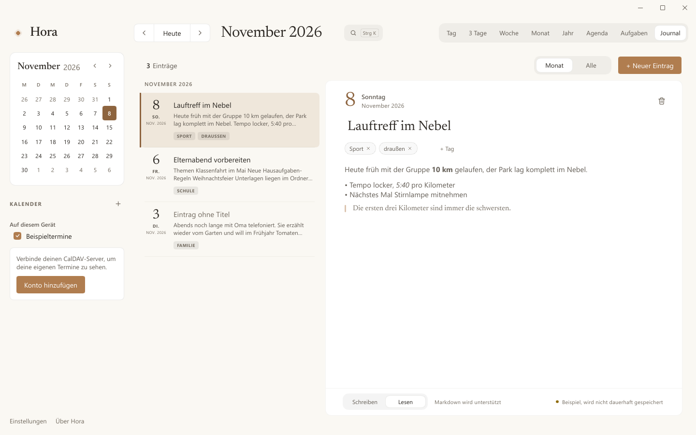

# Hora

*Ein ruhiger Desktop-Kalender für Windows: CalDAV-Termine, Aufgaben und ein Journal, nach dem Vorbild von [Calino](https://github.com/Ivan-Malinovski/calino).*

[English](README.md) · **Deutsch**



Hora ist ein nativer Kalender für Windows, geschrieben in Rust mit
[Slint](https://slint.dev) – ohne WebView. Hora gleicht mit deinem eigenen
CalDAV-Server ab (Baïkal, Radicale und andere), funktioniert offline und
startet in deutlich unter einer Sekunde mit rund 12 MB Arbeitsspeicher.

## Funktionen

- **CalDAV-Abgleich** mit automatischer Erkennung, Offline-Warteschlange und
  Konfliktdialog, wenn ein anderes Gerät denselben Termin geändert hat.
- **Acht Ansichten:** Tag, 3 Tage, Woche, Monat, Jahr, Agenda, Aufgaben und
  Journal.
- **Termine und Serien:** ziehen, Dauer ändern, „Nur dieser / Dieser und alle
  folgenden / Alle“, Erinnerungen als Windows-Benachrichtigung, auch aus dem
  Infobereich.
- **Aufgaben** mit Fälligkeit, Priorität und Teilaufgaben; ein **Journal** mit
  Markdown und Tags.
- Die **Schnelleingabe** macht aus „Zahnarzt morgen 15 Uhr bei Dr. Weber“
  einen Termin; die **Befehlspalette** (`Strg+K`) durchsucht alles.
- **Sieben Sprachen** (English, Deutsch, Français, Español, Italiano,
  Nederlands, Polski), hell und dunkel, komplett per Tastatur bedienbar.

| | |
|---|---|
|  |  |

## Installieren

`Hora-Setup-<Version>.exe` von [Releases](../../releases) herunterladen und
starten. Der Installer installiert nur für dein Benutzerkonto, ohne
Administratorrechte, und fragt zuerst nach der Sprache. Ein neuerer
Installer aktualisiert an Ort und Stelle; entfernen über Einstellungen → Apps.
Der Installer ist noch nicht signiert, SmartScreen kann deshalb beim ersten
Start warnen („Weitere Informationen“ → „Trotzdem ausführen“).

Für Skripte: `/S` installiert still, `/D=C:\Pfad` (als Letztes) wählt den
Ordner, `--lang=de`, `--no-autostart` und `--desktop-shortcut` setzen die
Optionen.

## Loslegen

Seitenleiste → **Konto hinzufügen**, dann DAV-Adresse (bei Baïkal z. B.
`http://server:8089/dav.php`), Benutzername und Passwort eingeben. Hora findet
die Kalender selbst; das Passwort liegt im Windows-Anmeldeinformationsspeicher.
Abgeglichen wird beim Start, alle 5 Minuten und mit `F5`.

Sprache sowie Datums- und Zeitformat lassen sich jederzeit unter
Einstellungen → Programm ändern. Die Schnelleingabe versteht in jeder
Oberflächensprache Deutsch und Englisch.

| Aktion | Tasten |
|---|---|
| Ansichten | `D` `X` `W` `M` `J` `L` `A` `B` (oder `1`–`8`) |
| Befehlspalette / Schnelleingabe | `Strg+K` / `Q` |
| Zurück / weiter / heute | `,` / `.` / `T` |
| Neuer Termin | `C` oder `N` |
| Gewählten Termin verschieben / Dauer ändern | Pfeiltasten / `Umschalt+↑↓` |
| Abgleichen / Einstellungen | `F5` / `Strg+,` |

## Bauen

Voraussetzungen: Windows, Rust 1.92+ (MSVC), die Visual Studio Build Tools
mit C++ und Python 3.

```
cargo run --release -p hora-app                                 # Hora starten
powershell -ExecutionPolicy Bypass -File tools\build-installer.ps1  # Hora-Setup-<Version>.exe bauen
cargo test --workspace                                          # Unit-Tests
```

Weitere Tests: CalDAV gegen Radicale und Baïkal in Docker
(`cargo test -p hora-caldav --test servers -- --ignored --test-threads=1`), ein
Ende-zu-Ende-Lauf (`tools\e2e-radicale.ps1`), der Installer-Test
(`tools\installer-test.ps1`) und ein Selbsttest der Oberfläche (`--selftest`,
Feature `devtools`). Die CI läuft bei jedem Push auf `main`; ein Tag `v1.2.3`
baut und veröffentlicht den Installer. Aufbau und Crates stehen im
[englischen README](README.md#build).

## Grenzen

- Nur HTTP Basic Auth; getestet mit Radicale und Baïkal.
- Die Übersetzungen außer Deutsch hat noch kein Muttersprachler
  gegengelesen – Korrekturen sind willkommen.
- Keine automatischen Updates; der Installer ist nicht signiert.

Änderungen stehen in [CHANGELOG.md](CHANGELOG.md).

## Lizenz

MIT, siehe [LICENSE](LICENSE). Design und Teile der Logik stammen von
[Calino](https://github.com/Ivan-Malinovski/calino) von Ivan Malinovski (MIT);
Hinweise zu Calino, der Schrift Newsreader und Slint in [NOTICE.md](NOTICE.md).
