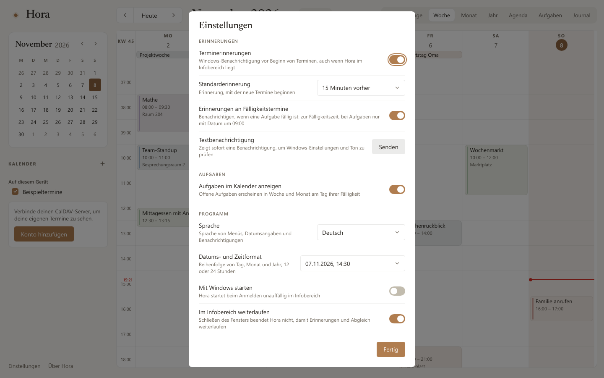

# Hora

*Ein ruhiger Desktop-Kalender für Windows: CalDAV-Termine, Aufgaben und ein Journal, nach dem Vorbild von [Calino](https://github.com/Ivan-Malinovski/calino).*

[English](README.md) · **Deutsch**


Hora ist ein nativer Kalender für Windows, komplett in Rust mit
[Slint](https://slint.dev) – ohne WebView, ohne Electron. Hora gleicht mit
deinem eigenen CalDAV-Server ab (Baïkal, Radicale und andere), funktioniert
auch offline und startet in deutlich unter einer Sekunde mit rund 12 MB
Arbeitsspeicher. Design und Verhalten folgen der Open-Source-Web-App Calino
(MIT); Hora ist ein eigenständiges Projekt, kein offizielles Calino-Programm.

## Auf einen Blick

- **Deine Kalender, dein Server.** CalDAV mit automatischer Erkennung, Abgleich
  per sync-token oder ctag/ETag, Offline-Warteschlange und Konfliktdialog,
  wenn ein anderes Gerät denselben Termin geändert hat.
- **Acht Ansichten.** Tag, 3 Tage, Woche, Monat, Jahr, Agenda, Aufgaben und
  Journal, dazu ein Mini-Kalender.
- **Termine, wie man sie erwartet.** Anlegen, ziehen, Dauer ändern, Serien mit
  „Nur dieser / Dieser und alle folgenden / Alle“, Erinnerungen als
  Windows-Benachrichtigung – auch aus dem Infobereich.
- **Aufgaben und Journal.** VTODO mit Fälligkeit, Priorität, Teilaufgaben und
  wiederkehrenden Aufgaben; VJOURNAL-Einträge mit Markdown und Tags.
- **Eintippen, fertig.** Die Schnelleingabe macht aus „Zahnarzt morgen 15 Uhr
  bei Dr. Weber“ einen Termin; die Befehlspalette (`Strg+K`) durchsucht alles
  und führt Befehle aus.
- **Sieben Sprachen.** English, Deutsch, Français, Español, Italiano,
  Nederlands, Polski – jederzeit umschaltbar, Datumsformate aus Windows oder
  in den Einstellungen gewählt.
- **Tastatur zuerst, hell und dunkel.** Alles geht per Tastatur; das Design
  folgt Windows.
- **Eigener Installer.** Pro Benutzer, ohne Administratorrechte, mit
  Sprachwahl auf der ersten Seite.

## Bilder

| | |
|---|---|
|  |  |
| Monat, dunkel | Journal mit Markdown |
|  |  |
| Einstellungen | Installer |

Weitere Bilder (englische Oberfläche) stehen im [englischen README](README.md#screenshots).

## Installieren

`Hora-Setup-<Version>.exe` von der Seite [Releases](../../releases)
herunterladen und starten.


- Installiert für dein Benutzerkonto nach `%LOCALAPPDATA%\Programs\Hora`, ohne
  Administratorrechte: Eintrag im Startmenü und unter Einstellungen → Apps,
  auf Wunsch „Mit Windows starten“ (vorgewählt) und eine Desktop-Verknüpfung.
- Die erste Seite fragt nach der Sprache; Hora startet dann in dieser Sprache.
- Ein erneuter Start des Installers aktualisiert an Ort und Stelle: Er beendet
  ein laufendes Hora und behält Ordner und Einstellungen.
- Entfernen über Einstellungen → Apps → Hora. Auf Wunsch gehen auch die
  lokalen Daten; die Termine auf dem CalDAV-Server bleiben immer unberührt.
- Jedes Release hat neben dem Installer eine `.sha256`-Datei
  (`Get-FileHash Hora-Setup-<Version>.exe` muss denselben Wert zeigen).
- Der Installer ist noch nicht signiert; Windows SmartScreen warnt deshalb
  beim ersten Start („Weitere Informationen“ → „Trotzdem ausführen“).

Still für Skripte: `/S`, anderer Ordner mit `/D=C:\Pfad` (als Letztes), dazu
`--lang=de`, `--no-autostart` und `--desktop-shortcut`. Still entfernen:
`"%LOCALAPPDATA%\Programs\Hora\uninstall.exe" /S`.

## Loslegen

Seitenleiste → **Konto hinzufügen** (oder das + neben „KALENDER“):

- **Server-Adresse:** die DAV-Adresse, bei Baïkal z. B.
  `http://server:8089/dav.php`. Hora findet Principal, Kalender-Sammlung und
  Kalender selbst (auch über `/.well-known/caldav`).
- **Benutzername und Passwort:** HTTP Basic Auth. Das Passwort liegt im
  Windows-Anmeldeinformationsspeicher, nie in Horas Datenbank. Bei `http://`
  warnt der Dialog, dass das Passwort unverschlüsselt übertragen wird.

Hora gleicht beim Start, alle 5 Minuten und auf Knopfdruck ab (Symbol oben
rechts oder `F5`). Abgeglichen werden alle Kalender, auch reine
Aufgabenlisten und Kalender nur für Journaleinträge; die Seitenleiste zeigt
sie alle zum Ein- und Ausblenden. Ohne Konto zeigen Beispieltermine und
Beispiel-Einträge, wie Hora aussieht; sie leben nur im Arbeitsspeicher.

## Funktionen

### Bearbeiten und offline

- Jede Änderung landet sofort im lokalen Cache und in einer Warteschlange;
  ein Hintergrund-Thread lädt sie hoch (`PUT` mit `If-Match` bzw.
  `If-None-Match: *`, `DELETE` mit `If-Match`).
- Ohne Netz warten Änderungen und werden nach 30 s, 1 min, 2 min … (höchstens
  stündlich) erneut versucht; die Kopfzeile zeigt „N Änderungen warten auf
  Übertragung“.
- Hat ein anderes Gerät den Termin inzwischen geändert (HTTP 412), fragt Hora:
  „Meine Version behalten“ oder „Server-Version übernehmen“.
- Unbekannte Eigenschaften (Alarme, Teilnehmer, Felder anderer Programme)
  bleiben beim Bearbeiten erhalten; neue Termine bekommen eine VTIMEZONE.

Daten liegen in `%LOCALAPPDATA%\Hora\hora.db` (SQLite). Fehler, die sonst
unsichtbar blieben, stehen in `%LOCALAPPDATA%\Hora\hora.log` (256 KB, dann
`hora.log.1`). Lässt sich die Datenbank nicht öffnen, meldet Hora das und
beendet sich, statt leer zu starten.

### Serien

Täglich, wöchentlich (an gewählten Wochentagen), monatlich (am selben Tag, am
n-ten oder letzten Wochentag) und jährlich, jeweils „alle n …“, mit Ende nie,
am Datum oder nach Anzahl. Darunter steht die Regel in Worten, z. B.
„Wöchentlich am Dienstag und Donnerstag, 4-mal“.

- **Nur dieser Termin:** eine Ausnahme (`RECURRENCE-ID` in derselben
  Ressource); Löschen setzt ein `EXDATE`.
- **Dieser und alle folgenden:** Die Serie wird geteilt, wie bei Thunderbird
  und Google – die alte endet davor, die neue beginnt als eigene Ressource;
  spätere Ausnahmen ziehen mit um.
- **Alle Termine der Serie:** Die Serie verschiebt sich um dieselbe Wandzeit
  wie der bearbeitete Termin, auch über die Zeitumstellung hinweg.
- Regeln anderer Programme, die der Dialog nicht darstellen kann (z. B.
  `BYMONTHDAY=1,15`), erscheinen als „Eigene Regel“ und bleiben unverändert.

### Erinnerungen und Infobereich

- Erinnerungs-Chips wie bei Calino, von „Zum Zeitpunkt des Termins“ bis
  „1 Woche vorher“; bei ganztägigen Terminen „Am Tag um 09:00“, „Am Vortag
  um 09:00“ usw. Neue Termine beginnen mit der Standarderinnerung
  (15 Minuten, änderbar).
- Die Benachrichtigung zeigt Titel, „In 15 Minuten · 15:00–16:00“ und den
  Ort; „Schlummern“ und „Schließen“ erledigt Windows. Ein Klick öffnet Hora
  an diesem Tag.
- Verpasste Erinnerungen kommen nach dem Start, solange der Termin nicht
  vorbei ist (bis 24 Stunden zurück), jede nur einmal. Was ein anderes Gerät
  schon weggeklickt hat (`ACKNOWLEDGED`, Thunderbirds `X-MOZ-LASTACK`), meldet
  Hora nicht noch einmal.
- Schließen des Fensters legt Hora in den Infobereich (abschaltbar);
  Rechtsklick zeigt „Hora öffnen“, „Jetzt synchronisieren“, „Einstellungen …“,
  „Beenden“. `hora --tray` startet ohne Fenster (Autostart).

### Aufgaben

- „N aktiv · M erledigt“, Filter „Alle / Aktiv / Erledigt“, „+ Aufgabe
  erstellen“ und eine Eingabezeile („Was muss erledigt werden?“).
- Gruppen nach Fälligkeit: Überfällig, Heute, Diese Woche, Später, Kein
  Fälligkeitsdatum, Erledigt.
- Teilaufgaben (`RELATED-TO;RELTYPE=PARENT`) stehen eingerückt und lassen
  sich einklappen; Abhaken oder Löschen nimmt offene Teilaufgaben mit.
- Wiederkehrende Aufgaben wie bei Thunderbird und Calino: ein erledigtes
  Vorkommen wird eine Ausnahme mit `STATUS:COMPLETED`; gezeigt wird das erste
  offene Vorkommen.
- Offene Aufgaben mit Fälligkeit erscheinen in Woche und Monat als
  ganztägiger Eintrag (abschaltbar); Erinnerung zur Fälligkeitszeit, bei
  Aufgaben nur mit Datum um 9:00.

### Journal

Freie Notizen an Kalendertagen, gespeichert als `VJOURNAL`:

- Liste nach Tag mit Wochentag, Titel, zwei Zeilen Text und Tags; „Monat /
  Alle“ und „+ Neuer Eintrag“.
- Editor mit Datum, optionalem Titel, Tags, Kalender und Text. „Schreiben /
  Lesen“: Lesen zeigt Markdown (Überschriften, Listen, fett, kursiv,
  durchgestrichen, `Code`, Zitate, Linien, Links). `Strg+B` / `Strg+I`
  formatieren die Auswahl.
- Gespeichert wird eine halbe Sekunde nach der letzten Eingabe; die Fußzeile
  zeigt „Gespeichert“, „Lokal gespeichert, wird übertragen“ (offline) oder
  einen Fehler.
- Ein Buch-Symbol im Monat markiert Tage mit Journaleinträgen. Nimmt kein
  Kalender Journaleinträge an, bietet Hora an, auf dem Server einen Kalender
  „Journal“ anzulegen.

### Schnelleingabe

`Q` (oder „Schnell eintragen“ in der Befehlspalette) öffnet ein Eingabefeld wie
Calinos Smart Input, mit einer Vorschau dessen, was entsteht. `Eingabe` legt
an, `Umschalt+Eingabe` öffnet den vorbefüllten Dialog. Die Schnelleingabe
versteht **Deutsch und Englisch**, unabhängig von der Sprache der Oberfläche:

| Eingabe | Ergebnis |
|---|---|
| `Mathe jeden Montag 8 Uhr bis 9:30 Raum 204` | wöchentlich montags 8:00–9:30, Ort „Raum 204“ |
| `Zahnarzt morgen 15 Uhr bei Dr. Weber` | morgen 15:00–16:00, Ort „Dr. Weber“ |
| `Chor dienstags und donnerstags 19 bis 21 Uhr bis 30.6.2027` | wöchentlich Di und Do bis 30.06.2027 |
| `Kurzurlaub vom 20.11. bis 23.11.` | ganztägig, vier Tage |
| `Lunch with Anna tomorrow at 1pm #Arbeit` | morgen 13:00 im Kalender „Arbeit“ |
| `todo Milch kaufen bis Freitag` | Aufgabe, fällig Freitag |
| `Planung morgen 10 Uhr Erinnerung 30 min vorher` | mit Erinnerung 30 Minuten vorher |

Ohne Uhrzeit wird der Termin ganztägig, ohne Ende dauert er eine Stunde. Was
nicht erkannt wird, bleibt im Titel; die Vorschau zeigt vor dem Anlegen, was
erkannt wurde.

### Befehlspalette

`Strg+K` (oder `/`, oder das Suchfeld in der Kopfzeile). Ohne Eingabe zeigt
sie die wichtigsten Befehle; beim Tippen sucht sie in Gruppen wie Calino:
Navigation (Ansichten, heute; ein Datum allein springt dorthin), Aktionen,
Einstellungen (auch Theme wechseln), Kalender (ein-/ausblenden), Termine,
Aufgaben, Journal und „Erstellen: …“ aus der Schnelleingabe. Alle Wörter
müssen vorkommen; Pfeile wählen, `Eingabe` führt aus, `Esc` schließt.

### Sprachen und Formate

- Standard ist Englisch. Einstellungen → Programm → **Sprache**: English,
  Deutsch, Français, Español, Italiano, Nederlands, Polski oder
  „Windows-Sprache“. Der Wechsel wirkt sofort – Menüs, Datumsangaben,
  Benachrichtigungen, das Menü im Infobereich und die Beispieldaten.
- **Datums- und Zeitformat:** „Windows“ folgt der Region in den
  Windows-Einstellungen (Reihenfolge Tag/Monat, 12 oder 24 Stunden); oder ein
  festes Format wie „07.11.2026, 14:30“.
- Datumsangaben folgen der Grammatik der Sprache („Montag, 9. November“,
  „lunes, 9 de noviembre“, „9 listopada“, „Ogni mese la prima domenica“).
- Datumsfelder verstehen das Format der Region, ISO-Daten und Wörter wie
  „heute“, „morgen“, „tomorrow“ oder „demain“; Uhrzeitfelder auch „2pm“ oder
  „9h30“.
- Die Übersetzungen liegen als gettext-Dateien in
  [`translations/`](translations); wie man sie verbessert oder eine Sprache
  ergänzt, steht in [translations/README.md](translations/README.md).

## Tastatur

| Aktion | Tasten |
|---|---|
| Ansichten | `D` Tag, `X` 3 Tage, `W` Woche, `M` Monat, `J`/`Y` Jahr, `L`/`G` Agenda, `A` Aufgaben, `B` Journal (oder `1`–`8`) |
| Befehlspalette | `Strg+K` oder `/` |
| Zurück / weiter / heute | `,` / `.` (oder Bild↑/↓), `T` |
| Neuer Termin | `C` oder `N`; im Raster wählen Pfeile die Zeit, `Eingabe` |
| Schnelleingabe | `Q` |
| Vorschau / bearbeiten / löschen | `Eingabe` auf einem Termin, `E`, `Entf` |
| Termin verschieben / Dauer ändern | Pfeile (±15 min, ±1 Tag), `Umschalt+↑/↓` |
| Jetzt abgleichen | `F5` |
| Einstellungen | `Strg+,` |
| Journal | `Strg+B` fett, `Strg+I` kursiv, `Esc` zum Lesen |

## Selbst bauen

Voraussetzungen: Windows, Rust 1.92 oder neuer (stable, MSVC), die Visual
Studio Build Tools mit „Desktopentwicklung mit C++“ und Python 3 für die
Hilfsskripte.

```
cargo run --release -p hora-app
powershell -ExecutionPolicy Bypass -File tools\build-installer.ps1
```

Der zweite Befehl baut `hora.exe` und das Setup-Programm und packt daraus
`target\installer\Hora-Setup-<Version>.exe`. Hora nutzt standardmäßig Slints
Software-Renderer (funktioniert per Remotedesktop, braucht am wenigsten
Speicher); einen anderen wählt z. B. `$env:SLINT_BACKEND = "winit-femtovg"`.

| Crate | Inhalt |
|---|---|
| `crates/core` | verlustfreier iCalendar-Parser, Zeitzonen, Serien expandieren und bearbeiten, Erinnerungen, Aufgaben, Journal, Schnelleingabe |
| `crates/caldav` | CalDAV-Client: Discovery, Sync, `If-Match`, MKCALENDAR |
| `crates/storage` | SQLite-Cache mit Migrationen, Änderungs-Warteschlange, gezeigte Erinnerungen |
| `crates/platform` | Windows: Anmeldeinformationsspeicher, Benachrichtigungen, Infobereich, Einzelinstanz, Autostart, Sprache und Region |
| `crates/i18n` | Übersetzungen für Slint und Rust, Mehrzahlregeln, Datumsgrammatik je Sprache |
| `crates/app` | Slint-Oberfläche (`ui/*.slint`), Sync-Thread, Ansichten, Bearbeiten, Aufgaben, Journal, Erinnerungen, Befehlspalette |
| `crates/setup` | Hora Setup: Installer und Deinstallation mit eigener Slint-Oberfläche |

## Tests

```
cargo test --workspace                                                 # Unit-Tests
cargo test -p hora-caldav --test servers -- --ignored --test-threads=1 # Radicale + Baïkal in Docker
cargo test -p hora-platform -- --ignored                               # Passwortspeicher, Registry, echte Benachrichtigung
python tools/i18n.py check                                             # alle Sprachen vollständig
```

Ende-zu-Ende gegen einen Radicale-Container mit Testdaten (nie gegen echte
Daten oder den echten Passwortspeicher): Hora verbindet sich, bearbeitet
Termine und Serien, arbeitet mit Aufgaben, Schnelleingabe, Palette und Journal,
und das Skript prüft das Ergebnis auf dem Server (34 Prüfungen).

```
cargo build -p hora-app --features devtools
powershell -ExecutionPolicy Bypass -File tools\e2e-radicale.ps1 -Exe target\debug\hora.exe -EditTest
```

Infobereich und Installer (eigener Datenordner; der Installer-Test
installiert still in einen Testordner, aktualisiert, startet Hora und
deinstalliert – 21 Prüfungen):

```
powershell -ExecutionPolicy Bypass -File tools\shell-test.ps1 -Exe target\release\hora.exe
powershell -ExecutionPolicy Bypass -File tools\installer-test.ps1 -Setup target\installer\Hora-Setup-<Version>.exe
```

Entwicklerwerkzeuge (Feature `devtools`): `--selftest` bedient die Oberfläche
mit synthetischen Eingaben (Ziehen, Tastatur, Palette, Journal, Sprach- und
Formatwechsel; 31 Prüfungen), `--snapshot bild.png`, `--view 0–7`,
`--settings`, `--quick <text>`, `--palette <text>`, `--journal <titel>`,
`--fill-test-data`, `--time-views` und mehr. Umgebung: `HORA_DATA_DIR`,
`HORA_CREDENTIALS=memory`, `HORA_THEME=light|dark`, `HORA_LANGUAGE=de`,
`HORA_FORMATS=dmy-dot`. Das Setup hat `--snapshot <png> <Seite> <Modus>` und
`--autopilot` (klickt Installation bzw. Entfernen durch).

Messung zu Version 1.0 (Release-Build, Software-Renderer, Windows 11 per
Remotedesktop; Start = Prozessstart bis fertig aufgebaute Ansicht, Speicher =
privater Arbeitssatz nach 10 s Leerlauf):

| Daten | Start | Speicher |
|---|---|---|
| leer (erster Start) | 69–79 ms | 12,3–12,6 MB |
| 3444 Termine, 60 Serien, 400 Aufgaben, 300 Journaleinträge | 61–69 ms | 18,7–19,0 MB |

## CI und Releases

`ci.yml` läuft bei jedem Push auf `main` und bei Pull Requests: Formatierung,
Clippy, alle Unit-Tests, Lizenzliste, Übersetzungen, Mindestversion von Rust
und der Selbsttest der Oberfläche unter Windows; die plattformunabhängigen
Crates und die Integrationstests gegen Radicale und Baïkal unter Linux.
`release.yml` baut und testet bei einem Tag `v1.2.3` (muss zur Version in
`Cargo.toml` passen) den Installer und legt ein GitHub-Release mit Installer,
Prüfsumme und dem Abschnitt aus [CHANGELOG.md](CHANGELOG.md) an.

## Bekannte Grenzen

- Die Schnelleingabe versteht nur Deutsch und Englisch. Die Übersetzungen ins
  Französische, Spanische, Italienische, Niederländische und Polnische hat
  noch kein Muttersprachler gegengelesen – Korrekturen sind willkommen.
- Nur HTTP Basic Auth (Baïkal: `dav_auth_type: Basic`). Getestet gegen
  Radicale 3.9 und Baïkal 0.10.1.
- Einen bestehenden Termin in einen anderen Kalender verschieben geht noch
  nicht; Termine über Mitternacht lassen sich nur im Dialog ändern, nicht per
  Ziehen.
- Neue wiederkehrende Aufgaben lassen sich in Hora noch nicht anlegen
  (bestehende abhaken und bearbeiten geht); Erinnerungen an Aufgaben
  (`VALARM`) bleiben erhalten, lassen sich aber nicht bearbeiten.
- Weggeklickte Erinnerungen meldet Hora nicht an den Server zurück.
- Keine automatischen Updates; ein neuer Installer aktualisiert an Ort und
  Stelle. Der Installer ist etwa 18 MB groß und nicht signiert.
- Nach der Deinstallation bleiben Passwörter im
  Windows-Anmeldeinformationsspeicher stehen (Einträge `konto-….Hora`).

## Lizenz

MIT, siehe [LICENSE](LICENSE). Design und Teile der Logik stammen von
[Calino](https://github.com/Ivan-Malinovski/calino) von Ivan Malinovski (MIT);
die Schrift Newsreader steht unter der SIL Open Font License; Slint wird unter
seiner Royalty-free-Lizenz genutzt. Einzelheiten in [NOTICE.md](NOTICE.md) und
[THIRD_PARTY_LICENSES](THIRD_PARTY_LICENSES).
