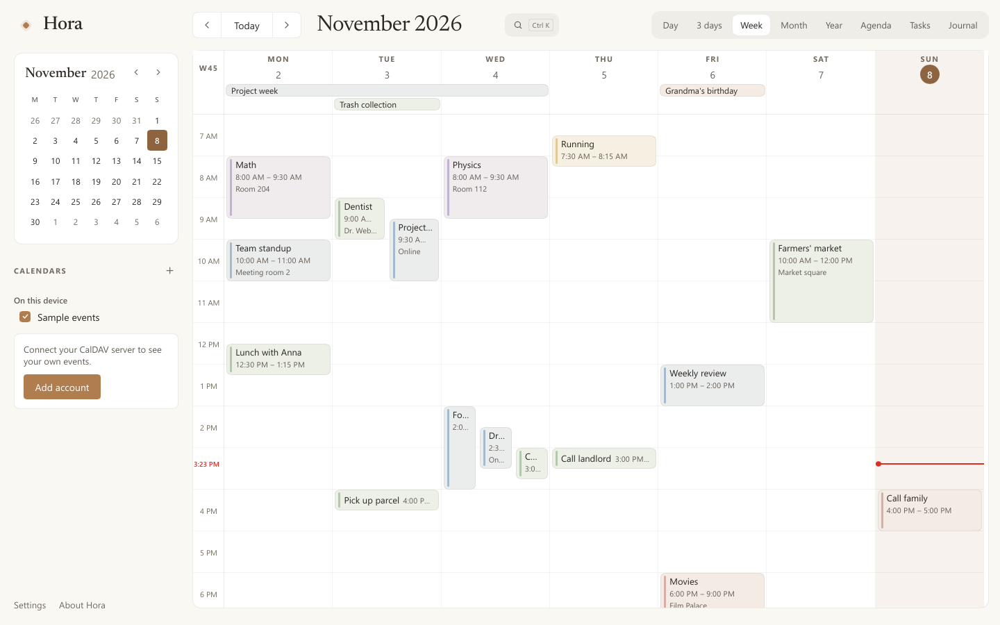
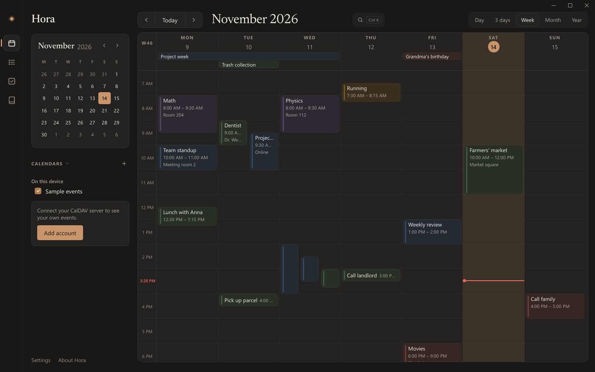
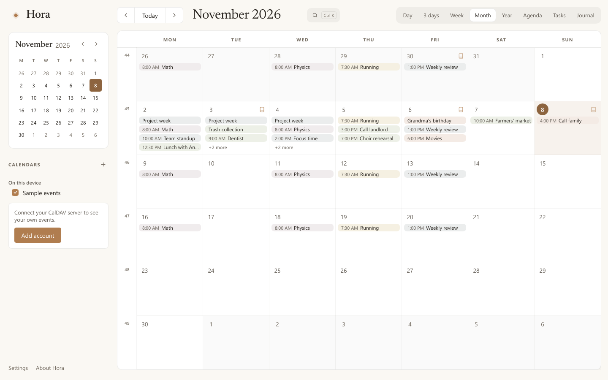
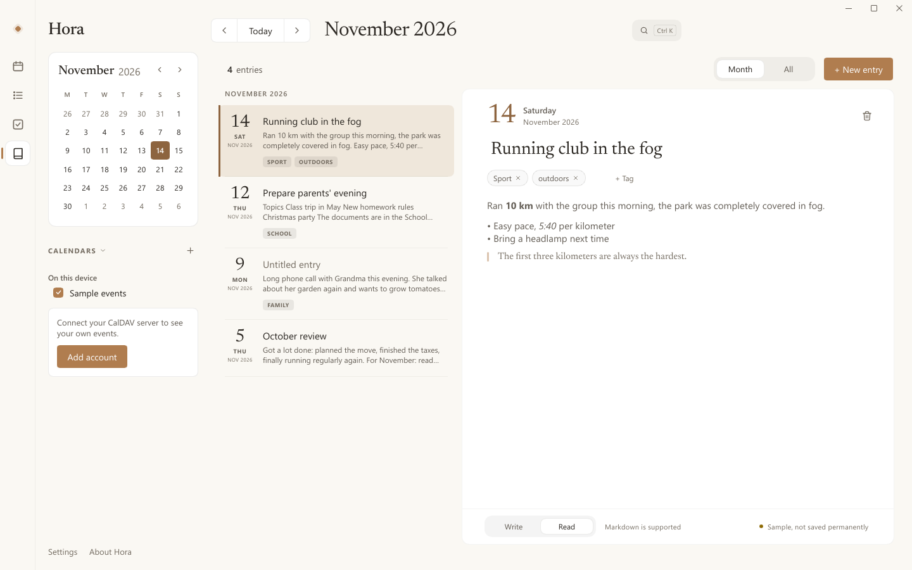
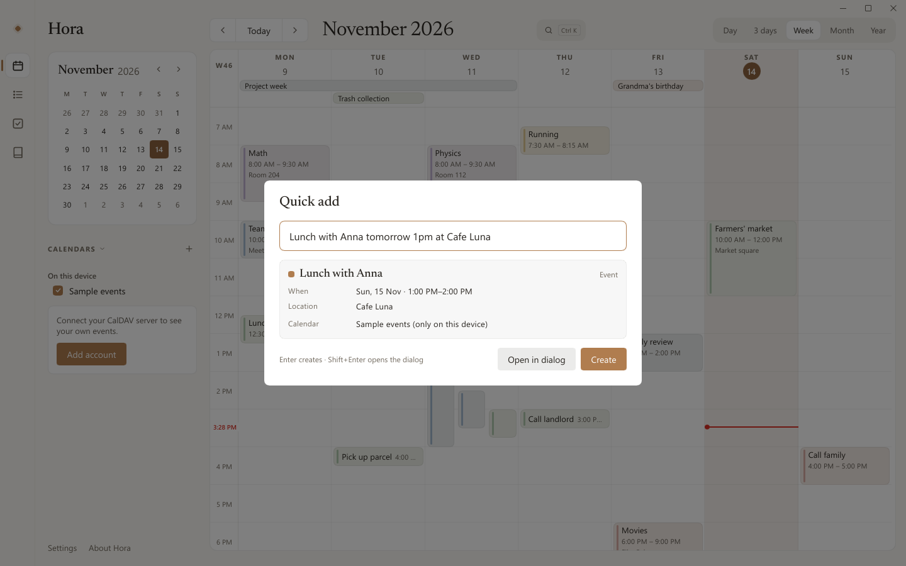

# Hora

*A calm desktop calendar for Windows: CalDAV events, tasks and a journal, in the style of [Calino](https://github.com/Ivan-Malinovski/calino).*

**English** · [Deutsch](README.de.md)



Hora is a native Windows calendar written in Rust with [Slint](https://slint.dev)
– no web view. It syncs with your own CalDAV server (Baïkal, Radicale and
others), works offline and starts in well under a second with around 12 MB of
memory.

## Features

- **CalDAV sync** with automatic discovery, an offline queue and a conflict
  dialog when another device changed the same event.
- **Eight views:** day, 3 days, week, month, year, agenda, tasks and journal.
- **Events and series:** drag, resize, "only this / this and following / all",
  reminders as Windows notifications, also from the notification area.
- **Tasks** with due dates, priorities and subtasks; a **journal** with
  Markdown and tags.
- **Quick add** turns "Lunch with Anna tomorrow 1pm at Cafe Luna" into an
  event; the **command palette** (`Ctrl+K`) searches everything.
- **App time** (optional, off by default): counts how long you actively use
  the programs of an activity – only while one is in front and you use the
  mouse, keyboard or pen. The sidebar shows this week's time; the overview
  adds the total, the month, a history by week or month and your sessions.
  The times stay on your PC.
- **Seven languages** (English, Deutsch, Français, Español, Italiano,
  Nederlands, Polski), light and dark mode, fully usable from the keyboard.

| | |
|---|---|
|  |  |
|  |  |

## Install

Download `Hora-Setup-<version>.exe` from [Releases](../../releases) and run
it. It installs for your user account only, without administrator rights, and
asks for the language first. Running a newer installer updates in place;
uninstall via Settings → Apps. The installer isn't code-signed yet, so
SmartScreen may warn on first start ("More info" → "Run anyway").

For scripts: `/S` installs silently, `/D=C:\Path` (last) picks the folder,
`--lang=de`, `--no-autostart` and `--desktop-shortcut` set the options.

**Updates:** once a day Hora looks for a new version here on GitHub and
downloads it in the background. When it's ready, the title bar shows
"Hora 1.2.0 is ready · Restart to update"; a click installs it and starts Hora
again. Updates are signed, and Hora checks the signature, size and checksum
before installing. The check only asks github.com for the latest release (it
sends your IP address and `Hora/<version>`, nothing else); turn it off in
Settings → Updates.

## Getting started

Sidebar → **Add account**, then enter the DAV address (for Baïkal e.g.
`http://server:8089/dav.php`), username and password. Hora finds the
calendars itself; the password is kept in Windows Credential Manager. Hora
syncs at startup, every 5 minutes and with `F5`.

Language and date/time format can be changed any time under Settings →
General. Quick add understands English and German in every UI language.

| Action | Keys |
|---|---|
| Views | `D` `X` `W` `M` `Y` `L` `A` `B` (or `1`–`8`) |
| Command palette / quick add | `Ctrl+K` / `Q` |
| Previous / next / today | `,` / `.` / `T` |
| New event | `C` or `N` |
| Move / resize the selected event | arrow keys / `Shift+↑↓` |
| Sync / settings | `F5` / `Ctrl+,` |

## Build

Requires Windows, Rust 1.92+ (MSVC), the Visual Studio Build Tools with C++
and Python 3.

```
cargo run --release -p hora-app                                 # run Hora
powershell -ExecutionPolicy Bypass -File tools\build-installer.ps1  # build Hora-Setup-<version>.exe
cargo test --workspace                                          # unit tests
```

More tests: CalDAV against Radicale and Baïkal in Docker
(`cargo test -p hora-caldav --test servers -- --ignored --test-threads=1`), an end-to-end run
(`tools\e2e-radicale.ps1`), the installer test (`tools\installer-test.ps1`),
the update test (`tools\update-test.ps1`: installs, offers a signed update on a
local server, clicks it, checks the restart) and a UI self-test (`--selftest`,
feature `devtools`). CI runs on every push to `main`; a tag `v1.2.3` builds
and publishes the installer.

Releases sign `update.txt` with the secret `HORA_UPDATE_KEY`, an Ed25519 key
whose public half is built into Hora (`crates/update/src/lib.rs`). It was
created once with `cargo run -p hora-update --bin hora-sign -- keygen <file>`;
keep it safe – without it, installed copies won't accept new updates.

| Crate | Contents |
|---|---|
| `core` | iCalendar, time zones, recurrence, tasks, journal, quick add |
| `caldav` | CalDAV client |
| `storage` | SQLite cache and change queue |
| `platform` | Windows integration (credentials, notifications, tray, autostart) |
| `i18n` | translations and date formats ([how to translate](translations/README.md)) |
| `app` | the Slint UI |
| `setup` | the installer |
| `update` | update check, download and signature check; `hora-sign` for releases |

## Limitations

- Only HTTP Basic Auth; tested with Radicale and Baïkal.
- Translations other than German haven't been reviewed by native speakers
  yet – corrections are welcome.
- The installer isn't code-signed yet, so SmartScreen warns on first start.

Changes are listed in [CHANGELOG.md](CHANGELOG.md).

## License

MIT, see [LICENSE](LICENSE). Design and parts of the logic are based on
[Calino](https://github.com/Ivan-Malinovski/calino) by Ivan Malinovski (MIT);
details on Calino, the Newsreader font and Slint in [NOTICE.md](NOTICE.md).
