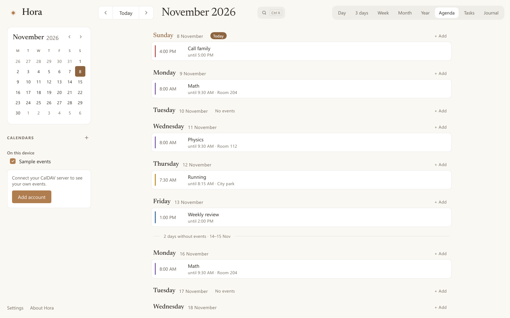
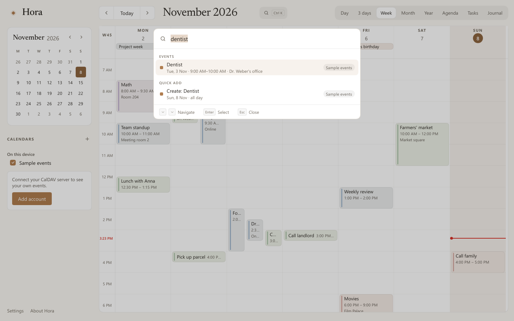
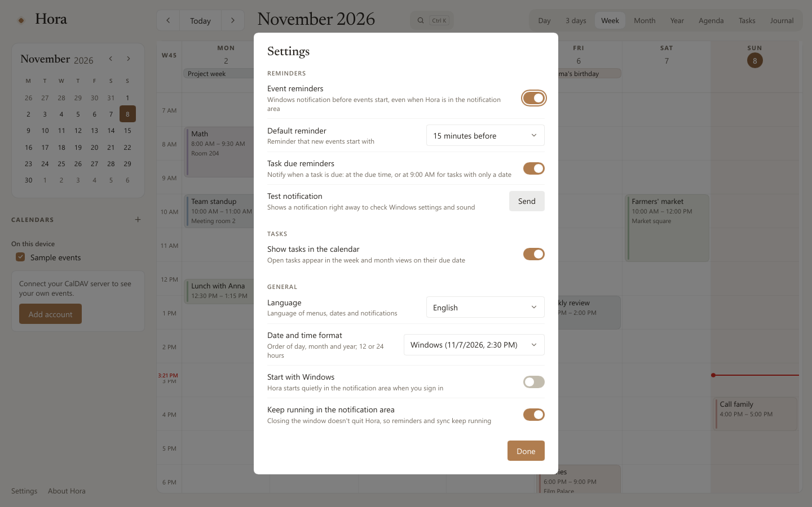

# Hora

*A calm desktop calendar for Windows: CalDAV events, tasks and a journal, in the style of [Calino](https://github.com/Ivan-Malinovski/calino).*

**English** · [Deutsch](README.de.md)


Hora is a native calendar for Windows, written entirely in Rust with
[Slint](https://slint.dev) – no web view, no Electron. It syncs with your own
CalDAV server (Baïkal, Radicale and others), keeps working offline and starts
in well under a second with around 12 MB of memory. Design and behavior follow
the open-source web app Calino (MIT); Hora is an independent project, not an
official Calino app.

## Highlights

- **Your calendars, your server.** CalDAV with automatic discovery, sync via
  sync-token or ctag/ETag, an offline queue and a conflict dialog when
  another device changed the same event.
- **Eight views.** Day, 3 days, week, month, year, agenda, tasks and journal,
  plus a mini calendar.
- **Events the way you expect.** Create, drag, resize, recurring series with
  "only this / this and following / all", reminders as Windows
  notifications – also from the notification area.
- **Tasks and journal.** VTODO with due dates, priorities, subtasks and
  recurring tasks; VJOURNAL entries with Markdown and tags.
- **Type it, done.** Quick add turns "Lunch with Anna tomorrow 1pm at Cafe
  Luna" into an event; the command palette (`Ctrl+K`) searches everything and
  runs commands.
- **Seven languages.** English, Deutsch, Français, Español, Italiano,
  Nederlands, Polski – switchable at any time, with date formats from Windows
  or chosen in Settings.
- **Keyboard first, light and dark.** Every action works from the keyboard;
  the theme follows Windows.
- **Its own installer.** Per user, no administrator rights, language choice
  on the first page.

## Screenshots

| | |
|---|---|
|  |  |
| Week, dark | Month |
|  |  |
| Agenda | Journal with Markdown |
|  |  |
| Quick add | Command palette |
|  |  |
| Settings | Hora Setup |

## Install

Download `Hora-Setup-<version>.exe` from the
[Releases](../../releases) page and run it.


- Installs for your user account to `%LOCALAPPDATA%\Programs\Hora`, without
  administrator rights: Start menu entry, entry under Settings → Apps,
  optionally "Start with Windows" (preselected) and a desktop shortcut.
- The first page asks for the language; Hora starts in that language.
- Running the installer again updates in place: it closes a running Hora and
  keeps the folder and your choices.
- Uninstall via Settings → Apps → Hora. You can also delete the local data;
  your events on the CalDAV server are never touched.
- Each release has a `.sha256` file next to the installer
  (`Get-FileHash Hora-Setup-<version>.exe` must show the same value).
- The installer isn't code-signed yet, so Windows SmartScreen warns on first
  start ("More info" → "Run anyway").

Silent install for scripts: `/S`, another folder with `/D=C:\Path` (last
argument), plus `--lang=de`, `--no-autostart` and `--desktop-shortcut`.
Silent uninstall: `"%LOCALAPPDATA%\Programs\Hora\uninstall.exe" /S`.

## Getting started

Sidebar → **Add account** (or the + next to "CALENDARS"):

- **Server address:** the DAV address, for Baïkal e.g.
  `http://server:8089/dav.php`. Hora finds the principal, the calendar home
  and the calendars itself (also via `/.well-known/caldav`).
- **Username and password:** HTTP Basic Auth. The password is kept in Windows
  Credential Manager, never in Hora's database. With `http://` the dialog
  warns that the password travels unencrypted.

Hora syncs at startup, every 5 minutes and on demand (icon top right or
`F5`). All calendars are synced, including pure task lists and journal-only
calendars; the sidebar lists them all to show or hide. Without an account,
sample events and journal entries show what Hora looks like; they live in
memory only.

## Features

### Editing and offline

- Every change goes straight into the local cache and a queue; a background
  thread uploads it (`PUT` with `If-Match` or `If-None-Match: *`, `DELETE`
  with `If-Match`).
- Offline, changes wait and are retried after 30 s, 1 min, 2 min … (at most
  hourly); the header shows "N changes waiting to upload".
- If another device changed the event meanwhile (HTTP 412), Hora asks: "Keep
  my version" or "Use server version".
- Unknown properties (alarms, attendees, fields of other apps) survive
  editing; new events get a VTIMEZONE.

Data lives in `%LOCALAPPDATA%\Hora\hora.db` (SQLite). Errors that would
otherwise go unnoticed are written to `%LOCALAPPDATA%\Hora\hora.log` (256 KB,
then `hora.log.1`). If the database can't be opened, Hora says so and quits
instead of starting empty.

### Recurring events

Daily, weekly (on chosen weekdays), monthly (same day, nth or last weekday)
and yearly, each "every n …", ending never, on a date or after a count. The
rule is shown in words, e.g. "Weekly on Tuesday and Thursday, 4 times".

- **Only this event:** an exception (`RECURRENCE-ID` in the same resource);
  deleting sets an `EXDATE`.
- **This and all following:** the series is split like Thunderbird and
  Google do it – the old one ends before, the new one starts as its own
  resource; later exceptions move along.
- **All events in the series:** the series moves by the same wall-clock time
  as the edited event, also across daylight saving changes.
- Rules from other apps that the dialog can't show (e.g.
  `BYMONTHDAY=1,15`) appear as "Custom rule" and stay untouched.

### Reminders and notification area

- Reminder chips like Calino's, from "At time of event" to "1 week before";
  for all-day events "On the day at 09:00", "The day before at 09:00" and so
  on. New events start with the default reminder (15 minutes, changeable).
- Notifications show title, "In 15 minutes · 3:00 PM–4:00 PM" and location;
  Windows handles "Snooze" and "Dismiss". A click opens Hora at that day.
- Missed reminders arrive after startup while the event isn't over (up to 24
  hours back), each only once. Reminders dismissed on another device
  (`ACKNOWLEDGED`, Thunderbird's `X-MOZ-LASTACK`) are not shown again.
- Closing the window keeps Hora in the notification area (can be turned
  off); right-click for "Open Hora", "Sync now", "Settings…", "Quit".
  `hora --tray` starts without a window (autostart).

### Tasks

- "N active · M done", filters "All / Active / Done", "+ Create task" and a
  quick input line ("What needs to be done?").
- Groups by due date: Overdue, Today, This week, Later, No due date, Done.
- Subtasks (`RELATED-TO;RELTYPE=PARENT`) are indented and collapsible;
  completing or deleting a task includes its open subtasks.
- Recurring tasks like Thunderbird and Calino: a completed occurrence becomes
  an exception with `STATUS:COMPLETED`; the first open occurrence is shown.
- Open tasks with a due date appear in week and month as all-day items (can
  be turned off); due reminders at the due time, or at 9:00 for date-only
  tasks.

### Journal

Free notes on calendar days, stored as `VJOURNAL`:

- List by day with weekday, title, two lines of text and tags; "Month / All"
  and "+ New entry".
- Editor with date, optional title, tags, calendar and text. "Write / Read":
  Read renders Markdown (headings, lists, bold, italic, strikethrough,
  `code`, quotes, rules, links). `Ctrl+B` / `Ctrl+I` format the selection.
- Saves half a second after the last keystroke; the footer shows "Saved",
  "Saved locally, uploading" (offline) or an error.
- A book icon in the month view marks days with journal entries. If no
  calendar accepts journal entries, Hora offers to create a "Journal"
  calendar on the server.

### Quick add

`Q` (or "Quick add" in the command palette) opens an input like Calino's
smart input, with a preview of what will be created. `Enter` creates,
`Shift+Enter` opens the prefilled dialog. Quick add understands **English and
German**, whatever the UI language:

| Input | Result |
|---|---|
| `Lunch with Anna tomorrow at 1pm #Work` | tomorrow 1:00 PM in calendar "Work" |
| `Gym every other monday 7am` | every two weeks on Monday, 7:00 AM |
| `Math every Monday 8am to 9:30 room 204` | weekly, 8:00–9:30 AM, location "room 204" |
| `todo buy milk by Friday` | task, due Friday |
| `Planning tomorrow 10am remind 30 min before` | with a reminder 30 minutes before |
| `Zahnarzt morgen 15 Uhr bei Dr. Weber` | tomorrow 3:00–4:00 PM, location "Dr. Weber" |
| `Kurzurlaub vom 20.11. bis 23.11.` | all day, four days |

Without a time the event is all day; without an end it lasts one hour. Words
it doesn't understand stay in the title, and the preview shows what it
recognized before anything is created.

### Command palette

`Ctrl+K` (or `/`, or the search field in the header). Without input it
shows the main commands; typing searches in groups like Calino: navigation
(views, today; a date alone jumps there), actions, settings (incl. switching
the theme), calendars (show/hide), events, tasks, journal and "Create: …"
from quick add. All words must match; arrows select, `Enter` runs, `Esc`
closes.

### Languages and formats

- English is the default. Settings → General → **Language**: English,
  Deutsch, Français, Español, Italiano, Nederlands, Polski or "Windows
  language". The switch is immediate – menus, dates, notifications, the tray
  menu and the sample data.
- **Date and time format:** "Windows" follows the region in Windows settings
  (day/month order, 12 or 24 hours); or pick a fixed one like
  "07.11.2026, 14:30" or "11/07/2026, 2:30 PM".
- Dates follow each language's grammar ("Monday, 9 November", "lunes, 9 de
  noviembre", "9 listopada", "Ogni mese la prima domenica").
- Date fields accept the region's format, ISO dates and words like "today",
  "tomorrow", "morgen" or "demain"; time fields also take "2pm" or "9h30".
- Translations live in [`translations/`](translations) as gettext files;
  see [translations/README.md](translations/README.md) for how to improve or
  add a language.

## Keyboard

| Action | Keys |
|---|---|
| Views | `D` day, `X` 3 days, `W` week, `M` month, `Y`/`J` year, `L`/`G` agenda, `A` tasks, `B` journal (or `1`–`8`) |
| Command palette | `Ctrl+K` or `/` |
| Previous / next / today | `,` / `.` (or Page Up/Down), `T` |
| New event | `C` or `N`; in the grid arrows pick the time, `Enter` |
| Quick add | `Q` |
| Preview / edit / delete | `Enter` on an event, `E`, `Del` |
| Move / resize an event | arrows (±15 min, ±1 day), `Shift+↑/↓` |
| Sync now | `F5` |
| Settings | `Ctrl+,` |
| Journal | `Ctrl+B` bold, `Ctrl+I` italic, `Esc` to read |

## Build from source

Requirements: Windows, Rust 1.92 or newer (stable, MSVC), the Visual Studio
Build Tools with "Desktop development with C++", and Python 3 for the helper
scripts.

```
cargo run --release -p hora-app
powershell -ExecutionPolicy Bypass -File tools\build-installer.ps1
```

The second command builds `hora.exe` and the setup program and packs
`target\installer\Hora-Setup-<version>.exe`. Hora uses Slint's software
renderer by default (works over Remote Desktop, least memory); for another
one set e.g. `$env:SLINT_BACKEND = "winit-femtovg"`.

| Crate | Contents |
|---|---|
| `crates/core` | lossless iCalendar parser, time zones, recurrence expansion and editing, alarms, tasks, journal, quick add parser |
| `crates/caldav` | CalDAV client: discovery, sync, `If-Match`, MKCALENDAR |
| `crates/storage` | SQLite cache with migrations, change queue, shown reminders |
| `crates/platform` | Windows: Credential Manager, notifications, tray, single instance, autostart, language and region |
| `crates/i18n` | translations shared by Slint and Rust, plural rules, date grammar per language |
| `crates/app` | the Slint UI (`ui/*.slint`), sync thread, views, editing, tasks, journal, reminders, palette |
| `crates/setup` | Hora Setup: installer and uninstaller with its own Slint UI |

## Testing

```
cargo test --workspace                                                 # unit tests
cargo test -p hora-caldav --test servers -- --ignored --test-threads=1 # Radicale + Baïkal in Docker
cargo test -p hora-platform -- --ignored                               # credential store, registry, real notification
python tools/i18n.py check                                             # every language complete
```

End-to-end against a Radicale container with test data (never your real
data or credential store): Hora connects, edits events and series, works
with tasks, quick add, the palette and the journal, and the script checks the
result on the server (34 checks).

```
cargo build -p hora-app --features devtools
powershell -ExecutionPolicy Bypass -File tools\e2e-radicale.ps1 -Exe target\debug\hora.exe -EditTest
```

Notification area and installer (own data folder; the installer test
installs silently into a test folder, updates, starts Hora and uninstalls –
21 checks):

```
powershell -ExecutionPolicy Bypass -File tools\shell-test.ps1 -Exe target\release\hora.exe
powershell -ExecutionPolicy Bypass -File tools\installer-test.ps1 -Setup target\installer\Hora-Setup-<version>.exe
```

Developer tools (feature `devtools`): `--selftest` drives the UI with
synthetic input (dragging, keyboard, palette, journal, switching language and
format; 31 checks), `--snapshot image.png`, `--view 0–7`, `--settings`,
`--quick <text>`, `--palette <text>`, `--journal <title>`, `--fill-test-data`,
`--time-views` and more. Environment: `HORA_DATA_DIR`, `HORA_CREDENTIALS=memory`,
`HORA_THEME=light|dark`, `HORA_LANGUAGE=de`, `HORA_FORMATS=dmy-dot`. The setup
has `--snapshot <png> <page> <mode>` and `--autopilot` (clicks through install
or uninstall).

Measured for version 1.0 (release build, software renderer, Windows 11 over
Remote Desktop; start = process start to a fully built view, memory = private
working set after 10 s idle):

| Data | Start | Memory |
|---|---|---|
| empty (first start) | 69–79 ms | 12.3–12.6 MB |
| 3444 events, 60 series, 400 tasks, 300 journal entries | 61–69 ms | 18.7–19.0 MB |

## CI and releases

`ci.yml` runs on every push to `main` and on pull requests: format, Clippy,
all unit tests, license list, translation check, minimum Rust version and the
UI self-test on Windows; the platform-independent crates and the Radicale and
Baïkal integration tests on Linux. `release.yml` builds and tests the
installer for a tag `v1.2.3` (must match the version in `Cargo.toml`) and
publishes a GitHub release with the installer, its checksum and the notes
from [CHANGELOG.md](CHANGELOG.md).

## Known limitations

- Quick add understands English and German only. The French, Spanish,
  Italian, Dutch and Polish translations haven't been reviewed by native
  speakers yet – corrections are welcome.
- Only HTTP Basic Auth (Baïkal: `dav_auth_type: Basic`). Tested against
  Radicale 3.9 and Baïkal 0.10.1.
- Moving an existing event to another calendar isn't possible yet; events
  spanning midnight can only be changed in the dialog, not by dragging.
- New recurring tasks can't be created in Hora yet (existing ones can be
  completed and edited); task reminders (`VALARM`) are kept but not editable.
- Dismissed reminders aren't reported back to the server.
- No automatic updates; a new installer updates in place. The installer is
  about 18 MB and not code-signed.
- After uninstalling, passwords stay in Windows Credential Manager (entries
  `konto-….Hora`).

## License

MIT, see [LICENSE](LICENSE). Hora's design and parts of its logic are based
on [Calino](https://github.com/Ivan-Malinovski/calino) by Ivan Malinovski
(MIT); the Newsreader font is under the SIL Open Font License; Slint is used
under its royalty-free license. Details in [NOTICE.md](NOTICE.md) and
[THIRD_PARTY_LICENSES](THIRD_PARTY_LICENSES).
